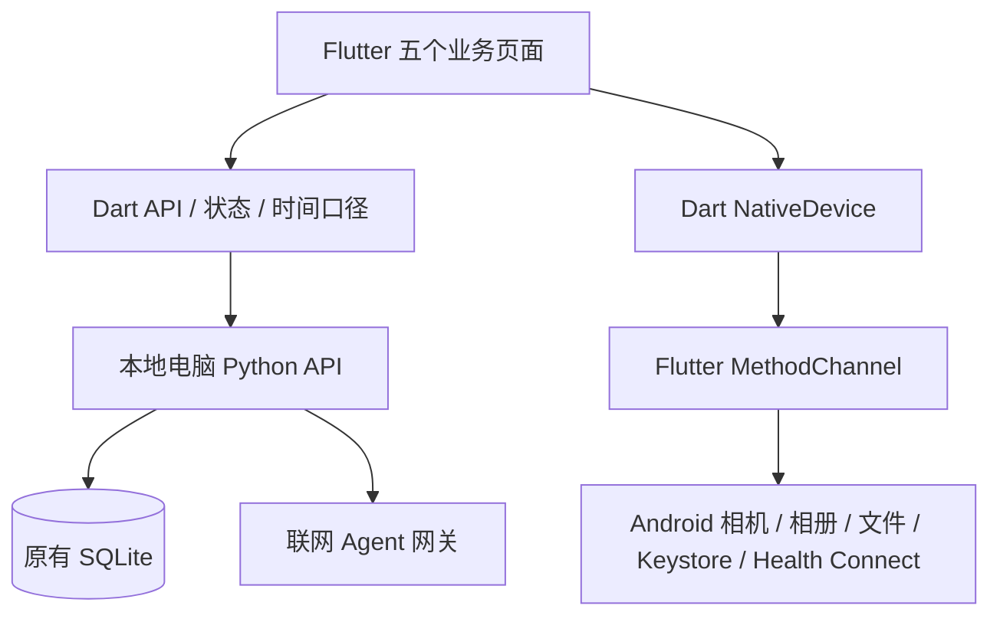

# Flutter 客户端迁移与验收

日期：2026-10-27。工作分支：`flutter-migration`；原生基线：`main`。

## 迁移结果与目录

`client` 已改为独立 Flutter 应用，UI 与交互位于 `client/lib`。旧的 `client/app`、`client/core`、`client/features` Kotlin 页面及根目录原生 Gradle 工程已移除；Android 宿主位于 `client/android`，用于启动 Flutter 引擎和调用系统能力。原生版本可通过 Git 分支查看。

`server` 的业务实现、API 和迁移 SQL 未因客户端迁移修改。个人正式数据库 `server/data/nutripulse.sqlite3` 未用于本次测试。所有验收数据使用 `tmp/flutter-migration-qa/nutripulse.sqlite3`，不上传 Git。

UI 保持五栏导航、饮食绿、健身橙红、蛋白蓝、脂肪黄、冰蓝，以及 16dp 白卡和 0.04 透明度阴影。界面代码使用 Flutter Widget，不通过 WebView 包装旧 HTML。



平台通道方案遵循 [Flutter 官方文档](https://docs.flutter.dev/platform-integration/platform-channels)。跨页面状态由 `AppController` 通知刷新，业务计算继续以服务端为准。

## 功能映射

| 范围 | Flutter 实现 | 验证依据 |
| --- | --- | --- |
| 五栏导航与视觉 | `lib/main.dart`、`lib/ui/design.dart` | 320 / 390 / 480dp 组件测试；模拟器五页截图 |
| 四餐账本、日期、宏量、饮水 | `features/diet/diet_page.dart`、`meal_editor.dart` | 真实 API 合约、计划转实际组件测试、模拟器首页 |
| 食品检索、常吃食物、g/ml/份/个 | `meal_editor.dart` | 份量缩放、未知宏量保留单元测试；服务端原接口 |
| 编辑、删除与撤销 | `diet_page.dart`、`meal_editor.dart` | 使用既有 PATCH / DELETE / restore 接口；撤销窗口仍由服务端约束 |
| 拍照与相册、照片清理、识餐复核 | `scan_page.dart`、Android `MainActivity` / `PhotoNormalizer` | 相册 → 原生归一化 → Mock Agent → 人工复核 → 确认入账的模拟器流程 |
| 照片草稿与未决写入 | Android `PhotoDraftStore` / `SecureValues`、`PendingWrite` | 原生照片加密实现保留；写入内容及去重键序列化测试 |
| 首页资讯 | `ArticleFeed` | PageView 图文卡；按电脑地址保存公开资讯缓存；无数据时不编造文章 |
| 有氧、自定义热量与 MET | `fitness_page.dart` | 真实接口校验按测量体重估算、账本与恢复建议 |
| 力量组、计时组、自重、RPE/RIR、休息 | `workout_editor.dart`、`prescription.dart` | 次数与秒数解析测试；实际接口中计时自重不产生虚假容量 |
| 六套官方计划与跟练 | `fitness_page.dart` | 真实接口验证六套目录、报名、当日处方、正确完成状态 |
| 设备导入、冲突处置与撤销 | `AppController`、`NativeDevice`、原生 Health Connect 适配器 | Android 构建通过；501 条样本分批、最后一批激活七天数据的测试；实际硬件未验收 |
| 预算推荐、份量、菜谱、反馈 | `features/eat/eat_page.dart` | 真实推荐/菜谱/半份预记与重复接受测试，模拟器推荐卡片 |
| 饮食偏好联动与过敏限制 | `profile_page.dart`、推荐请求 | 原有服务端约束继续执行；客户端读取个人默认用餐场景 |
| 盲盒转盘 | `BlindBoxDialog` / `WheelPainter` | 仅展示服务端已抽中的安全候选与候选池；抽取不在客户端绕过限制 |
| 多轮对话与确认预记 | `chat_page.dart` | Mock Agent 两轮合约测试、历史恢复、重复确认去重；模拟器回复与方案确认 |
| 周期统计、复合图、双轴与体重 | `features/analytics` | 日期范围单元测试、真实能量/宏量/身体接口校验、模拟器统计页 |
| 习惯、诊断与版本、PDF | `analytics_page.dart` | 真实习惯/诊断接口及有效 PDF 下载；版本保留 |
| 档案、测量、BMR/TDEE、目标预览 | `profile_page.dart` | 真实接口使用指纹确认目标；模拟器身体信息和目标卡片 |
| JSON 导出、隐私清空、诊断日志 | `profile_page.dart` / 原生文档选择器 | 实际导出和删除预览接口；清空需影响预览与确认短语 |
| 服务地址、配对与安全凭据 | `profile_page.dart` / `SecureTokenStore` | 地址边界单元测试；沿用原应用包名与加密令牌存储 |

## 已执行的检查

`flutter analyze --no-pub` 最终结果为 `No issues found`。

1. `flutter build apk --debug`：构建成功，包含 Flutter 引擎、Dart 页面和 Kotlin 系统桥接。
2. `flutter test --no-pub`：14 项通过。覆盖五栏多尺寸、离线连接入口、计划餐确认、未知值、份量缩放、冻结请求、日期、处方、Health Connect 分批激活及隐私清空与设备同步互斥。
3. `dart run tool/verify_server.dart http://127.0.0.1:8791`：23 项通过。使用真实 Dart HTTP 客户端与独立 Python 服务，覆盖档案 → 目标 → 饮食 → 训练计划 → 推荐 → 统计 → PDF / 隐私接口。
4. `dart run tool/verify_agents.dart http://127.0.0.1:8791 ../tmp/flutter-test-photo.jpg`：6 项通过。Mock Agent 用于验证协议、复核、两轮对话、历史和入账去重。
5. Android 模拟器 `Medium_Phone`：已覆盖安装 Flutter APK；五个主页面正常加载；执行推荐生成、相册选择、识餐复核及入账、饮食对话及确认预记；对应日志未发现 Flutter / Android 运行异常。

真实接口验收发现并修复了 Dart 默认分块请求与原 Python 服务 `Content-Length` 读取方式的兼容问题。餐食更新使用服务端实际支持的 PATCH。此前窄屏溢出已通过多尺寸测试复验。

运行截图见 [Flutter 运行证据](flutter-runtime-evidence/README.md)。旧原生版本截图位于 [历史验收](native-runtime-evidence/README.md)，不能当作 Flutter 版的验证证据。

## 在独立数据库中复现接口检查

先启动一个单独的测试服务，明确指定临时数据库和不同端口；不要对正式个人库运行这些会新增记录的脚本：

```powershell
cd E:\AndroidProject\AppDemo\server
$env:NUTRIPULSE_DB='E:\AndroidProject\AppDemo\tmp\flutter-qa-new\nutripulse.sqlite3'
$env:NUTRIPULSE_PORT='8791'
python run.py
```

另一个终端在 `client` 目录运行 `dart run tool/verify_server.dart http://127.0.0.1:8791`。脚本会写入合成档案、测量、饮食和训练。使用新的临时数据库目录，避免将重复运行产生的历史记录误判为第一次验收结果。

测试 Agent 时，运行 `python client/tool/mock_agent.py`，并让**测试服务**设置 `NUTRIPULSE_AGENT_URL=http://127.0.0.1:8899` 后重新启动。Mock 只支持识餐与饮食对话，不代表真实 AI 质量。第二个脚本需要自行准备有效的测试 JPEG 路径。

## 已知边界

- 本次目标是迁移现有 Android 客户端，当前生成和验证的宿主平台为 Android；未生成 iOS / 桌面宿主，也未接入 HealthKit。
- 真实联网 Agent 服务和真实穿戴设备未提供，未验收其响应质量、授权记录和数据准确度；没有宣称已直接连接 Apple Watch。
- 未执行全部原生设备测试、真实相机拍摄或生产发布签名测试。迁移保留了照片归一化和加密草稿的 Android 仪器测试源码，可在独立测试设备运行；测试草稿会清空本机草稿，不应直接用于有个人草稿的设备。
- 当前 Debug APK 用于个人 Demo。服务端个人数据仍需要独立备份；应用数据清空与分支切换不等同于数据库恢复。
